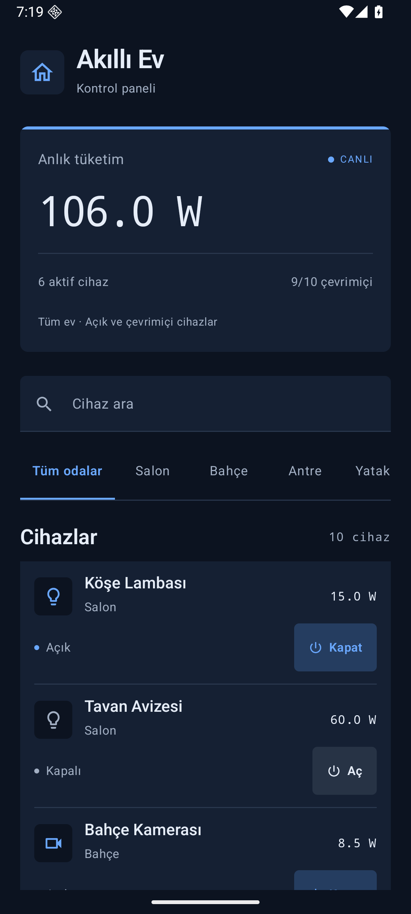

# Application Development in Mobile Systems

## week3_assignment - Akıllı Ev Kontrol Merkezi

Kotlin ve Jetpack Compose ile geliştirilmiş Android uygulaması. Cihaz araması, oda filtresi, aç/kapat kontrolü ve canlı güç sayacı içerir. MVVM, Jetpack ViewModel, Coroutines ve StateFlow kullanır.

- [Proje ve çalıştırma adımları](week3_assignment/README.md)
- [Test sonuçları](week3_assignment/DOGRULAMA.md)
- [Teslim PDF'si](week3_assignment/submission/week3_assignment_teslim.pdf)
- [Ekran görüntüleri](week3_assignment/screenshots)

Android Studio'da `week3_assignment` klasörünü açın. JDK 17 ve Android SDK 36 kullanılır. 14 birim testi ve 5 Android ekran testi başarılıdır. 120 FPS fiziksel cihaz ölçümü yapılmamıştır.

