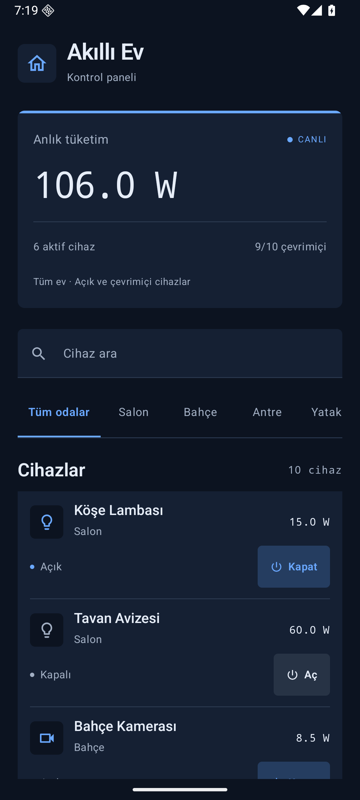
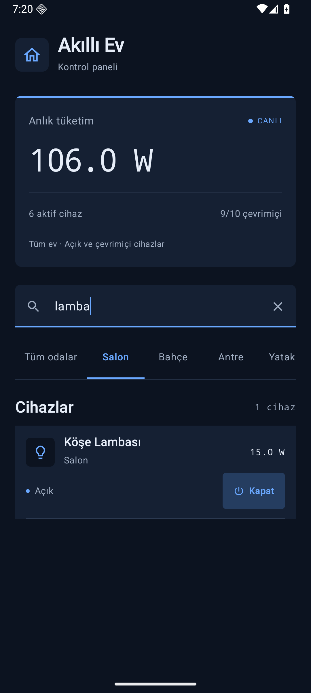

# week3_assignment - Akıllı Ev

Kotlin ve Jetpack Compose ile hazırlanmış Akıllı Ev (IoT) Kontrol Merkezi. Ödevdeki 10 cihaz, başlangıç durumları ve tüketim değerleri aynen kullanılır.

Koyu lacivert kontrol paneli; mavi vurgular, altı çizili oda sekmeleri ve kompakt cihaz listesi kullanır.

 

14 birim testi ve 5 Android ekran testi başarılı. Ayrıntılar: [doğrulama sonuçları](DOGRULAMA.md).

## Çalıştırma

1. Android Studio'da bu klasörü **Open** ile açın.
2. Gradle JDK olarak **JDK 17** seçin. Android SDK Platform 36 ve Build Tools 35.0.0 kurulu olmalıdır.
3. Gradle Sync işlemini tamamlayın.
4. Android 7.0 (API 24) veya üzeri bir cihaz/emülatör seçin ve `app` yapılandırmasını çalıştırın.

İlk açılışta toplam **106.0 W**, aktif cihaz sayısı **6**, çevrimiçi cihaz sayısı **9/10** olur. İlk senkronizasyonda bağımlılıkların indirilmesi için internet gerekir; uygulama çalışırken internet izni istemez.

Komut satırından:

```bash
./gradlew :app:assembleDebug
./gradlew :app:testDebugUnitTest :app:lintDebug
./gradlew :app:connectedDebugAndroidTest
```

Son komut, açık bir Android emülatörü veya USB hata ayıklaması etkin bir cihaz gerektirir. Windows'ta `gradlew.bat` kullanılır. Oluşturulan APK: `app/build/outputs/apk/debug/app-debug.apk`.

## Kullanım

- Cihaz adı araması Türkçe büyük/küçük harf kurallarını kullanır; örneğin `KÖŞE LAMBASI` ile `Köşe Lambası` eşleşir.
- Oda seçimi ve arama birlikte uygulanır. **Tüm odalar** yalnızca oda filtresini kaldırır; arama alanındaki temizleme düğmesi aramayı siler.
- **Aç/Kapat** cihazın durumunu değiştirir; enerji sayacı otomatik güncellenir.
- Sayaç her zaman **tüm evde açık ve çevrimiçi** olan cihazları toplar. Listeyi filtrelemek toplamı değiştirmez.
- Çevrimdışı cihazın kontrolü devre dışıdır. Veri katmanı da çevrimdışı komutları yok sayar.
- Cihaz kartındaki W değeri cihazın tanımlı güç değeridir; üst karttaki W değeri o anda tüketilen toplam güçtür. W anlık güç birimidir; kWh hesabı yapılmaz.
- Ödevin ham verisi bellek içindedir. Ekran döndürüldüğünde ViewModel korunur; uygulama süreci yeniden başladığında başlangıç verileri yüklenir. Gerçek IoT bağlantısı veya kalıcı veritabanı bu senaryonun kapsamı değildir.

## Mimari

```text
Compose HomeScreen
  | Kullanıcı olayı                    ^ HomeUiState
  v                                    |
HomeViewModel -- combine + flowOn(Default) --> StateFlow
  |                                    ^
  v                                    |
DeviceRepository <---- InMemoryDeviceRepository
                              |
                        SampleDevices
```

| Katman | Sorumluluk |
| --- | --- |
| `domain` | Değişmez `SmartDevice` modeli, kategoriler ve repository sözleşmesi |
| `data` | Ham veri, salt okunur `StateFlow`, atomik ve asenkron cihaz güncellemesi |
| `presentation` | Arama ve oda durumu; filtreleme, toplama, sayılar ve görüntülenecek metinler |
| `ui` | Hazır durumu çizmek ve kullanıcı olaylarını callback olarak iletmek |
| `MainActivity` | ViewModel fabrikası ve `collectAsStateWithLifecycle` ile yaşam döngüsüne uygun bağlama |

`HomeScreen` ve alt bileşenleri stateless'tir. UI'da `.filter`, `.sumOf`, cihaz sayımı veya iş durumu tutan `remember` / `mutableStateOf` bulunmaz. `LazyColumn` / `LazyRow` yalnızca ViewModel'in hazırladığı verileri çizer.

`combine(repository.devices, searchQuery, selectedRoom)` her değişiklikte tek bir tutarlı `HomeUiState` üretir. Tüm filtreleme, toplam ve metin biçimlendirme işlemleri `flowOn(defaultDispatcher)` ile ana thread dışındadır. `stateIn(viewModelScope, SharingStarted.WhileSubscribed(5_000), ...)` ekranın izleyebileceği salt okunur bir `StateFlow` sağlar. İlk veri hazırlanırken yükleniyor durumu gösterilir.

Arama alanının ham metni ayrıca ViewModel'deki salt okunur `searchQuery` StateFlow'undan doğrudan izlenir. Böylece her tuşun ekrandaki geri bildirimi arka plan hesabını beklemez; hızlı yazmada eski metnin geri gelmesi veya harf kaybı önlenir. Filtrelenmiş liste ve sayaç yine asenkron `HomeUiState` üzerinden gelir. Her iki state'in sahibi ViewModel'dir; Compose içinde yerel iş durumu tutulmaz.

Repository, `withContext(defaultDispatcher)` içinde `MutableStateFlow.update` kullanır. Bu atomik işlem hızlı veya eşzamanlı tıklamaların birbirinin güncellemesini ezmesini önler. Dispatcher constructor üzerinden enjekte edilir; testlerde sanal zamanlı dispatcher kullanılabilir. CPU işi için `Default` seçilmiştir; mevcut örnekte ağ/disk I/O işlemi yoktur.

## Doğrulama senaryoları

Her satır bağımsız olarak başlangıç durumundan denenebilir.

| İşlem | Beklenen sonuç |
| --- | --- |
| İlk açılış | 10 cihaz; 106.0 W; 6 aktif; 9/10 çevrimiçi |
| Köşe Lambası kapat | 91.0 W |
| Köşe Lambası kapatıp tekrar aç | 106.0 W |
| Tavan Avizesi aç | 166.0 W |
| Mutfak Spotları aç | 151.0 W |
| Yatak Odası Kliması aç | 1306.0 W |
| Salon seç | 3 cihaz; toplam 106.0 W kalır |
| Salon seç + `kamera` ara | Boş sonuç; toplam 106.0 W kalır |
| `GİRİŞ` ara | Giriş Kamerası |
| Balkon Aydınlatması | Çevrimdışı; Aç düğmesi devre dışı |

Unit testler veri doğruluğunu, toplamı, filtrelerin birleşimini, Türkçe aramayı, çevrimdışı cihazları ve eşzamanlı güncellemeleri denetler. Compose testleri gerçek ekran üzerinde arama, filtreleme ve aç/kapat davranışlarını doğrular.

## Performans

UI thread'inde veri taraması veya toplam hesabı yapılmaz. Lazy listelerde kararlı cihaz kimlikleri kullanılır; durum yaşam döngüsüne uygun toplanır. Bunlar akıcı bir arayüz için alınan önlemlerdir. **120 FPS ölçülmüş veya garanti edilmiş bir sonuç değildir.** Bu hedef, 120 Hz destekleyen fiziksel cihazda release derlemesi ile Perfetto / Macrobenchmark kullanılarak ölçülmelidir. Emülatörün yenileme hızı ve debug derlemesi bu doğrulamanın yerine geçmez.

## Teslim

Projenin adı Gradle ayarlarında tam olarak `week3_assignment` olarak tanımlıdır.

- [GitHub deposu](https://github.com/vuralmehmetbatu-ops/Application-Development-in-Mobile-Systems-Homework)
- [Ekran görüntüleri ve depo bağlantısını içeren teslim PDF'si](submission/week3_assignment_teslim.pdf)

Gradle wrapper dosyaları projeye dahildir. Bilgisayara özel `local.properties`, `.gradle`, `.idea` ve `build` klasörleri `.gitignore` ile dışlanır.

## Resmî teknik kaynaklar

- [Android - State ve Compose](https://developer.android.com/develop/ui/compose/state)
- [Android - Coroutines için önerilen uygulamalar](https://developer.android.com/kotlin/coroutines/coroutines-best-practices)
- [Android - Compose BOM](https://developer.android.com/develop/ui/compose/bom)
- [Android Gradle Plugin 8.12 uyumluluğu](https://developer.android.com/build/releases/agp-8-12-0-release-notes)
